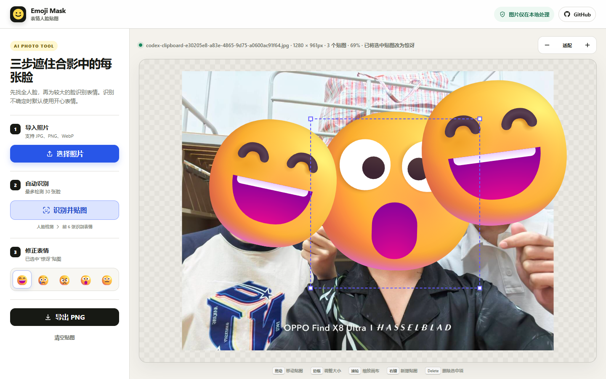

# 表情 Emoji 图片编辑器

一个本地网页小工具：上传图片后，在浏览器中识别人脸和近似表情，并自动覆盖 Unicode emoji，最后导出清晰 PNG 图片。



## 功能

- 导入本地图片进行编辑
- 使用 MediaPipe Face Detector 对整图和多尺度重叠分块进行人脸检测
- 仅对面积最大的前 6 张脸运行 Face Landmarker，根据 blendshape 近似识别开心、悲伤、生气、惊讶、中性五类表情
- 其余人脸默认使用开心 emoji，确保检测到的人脸都能立即遮住
- 自动将对应 Unicode emoji 覆盖到每张脸上
- 支持选中单张贴图后手动修改表情
- 在图片上右键添加开心 emoji
- 左键拖动 emoji 可移动位置
- 拖拽 emoji 的选中边框可等比例放大或缩小
- 新增 emoji 会沿用最近一次调整后的尺寸
- 支持滚轮缩放图片视图、拖拽平移图片
- 导出 PNG 时按原始图片尺寸重新绘制，保持画质清晰

## 使用方法

项目不需要安装依赖或启动后端服务，但由于浏览器的 ES Module 和本地文件安全限制，建议通过本地静态服务打开。

1. 点击“导入图片”选择本地图片。
2. 点击“识别并贴图”，自动处理图片中的全部人脸。多人合影会自动进行多尺度分块检测，单次最多处理 30 张脸；面积最大的前 6 张会进一步识别表情。
3. 左键拖动 emoji 调整位置，拖动边框调整大小。
4. 选中贴图后，可以从顶部 Unicode 表情栏修改它的表情。
5. 也可以在图片上右键添加开心 emoji。
6. 使用鼠标滚轮缩放图片视图，拖拽空白图片区域平移视图。
7. 点击“导出 PNG”保存编辑后的图片。

如果浏览器对本地文件访问限制较严格，也可以在项目目录运行本地静态服务：

```powershell
python -m http.server 5173 --bind 127.0.0.1
```

然后访问：

```text
http://127.0.0.1:5173/
```

## 项目结构

```text
.
├── index.html
├── styles.css
├── app.js
├── assets/
│   ├── demo.png
│   ├── emoji/        # 预留的后续风格资源，第一阶段不参与运行
│   └── models/       # 同源加载的官方 MediaPipe 人脸模型
└── README.md
```

## 技术说明

项目使用原生 HTML、CSS 和 JavaScript 实现。MediaPipe 运行时通过 CDN 加载，Face Detector 和 Face Landmarker 官方模型随静态站点同源提供，项目无需构建工具或后端服务。图片和识别结果只在浏览器本地处理，不会上传到服务器。

编辑数据保存在原始图片坐标系中，页面缩放和平移只影响预览视图；导出时会在离屏 canvas 中按原图尺寸重新绘制图片和 Unicode emoji。

识别采用两层结构：Face Detector 先处理整张图片和多个尺度的重叠分块，合并重复人脸框并为所有结果生成开心 emoji；Face Landmarker 再逐张处理面积最大的前 6 张脸，使用更精确的关键点和表情结果更新贴图。识别设置了约 9 秒的时间预算和 30 张脸的结果上限；侧脸、严重遮挡或尺寸过小的人脸仍可能无法识别。全部处理都在浏览器本地完成，不会上传图片。

表情识别是基于面部 blendshape 的近似分类，适合生成趣味贴纸，不代表医学或心理层面的情绪判断。无法明确判断、超过表情层人数上限或表情模型不可用时默认使用开心 emoji。Face Detector 不可用时会回退到 Face Landmarker 整图识别；两个模型都加载失败时仍可使用右键手动贴图和导出功能。不同操作系统和浏览器可能使用不同 emoji 字体，因此 Unicode emoji 的具体视觉样式会略有差异。首次识别需要网络加载 MediaPipe 运行时和模型。
